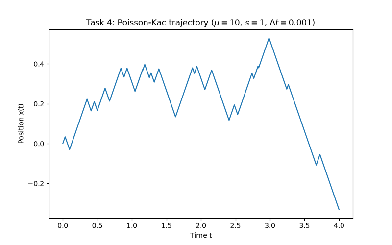
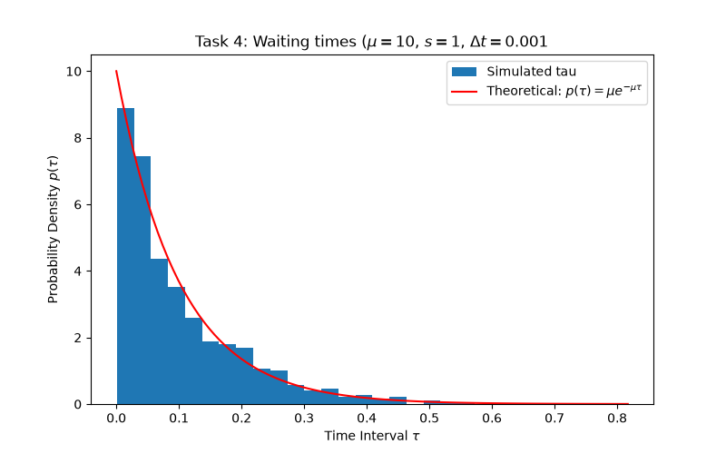
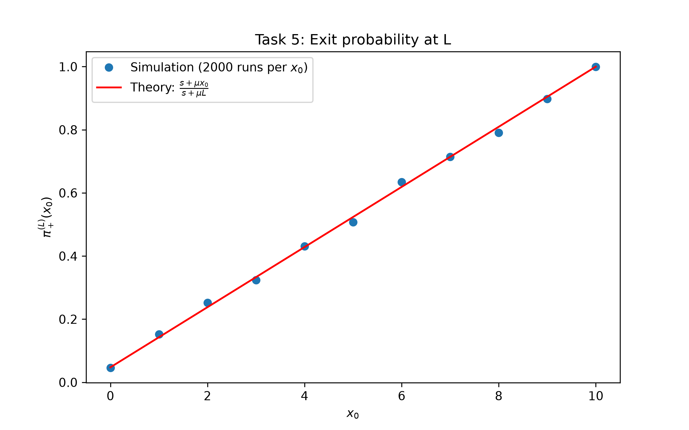
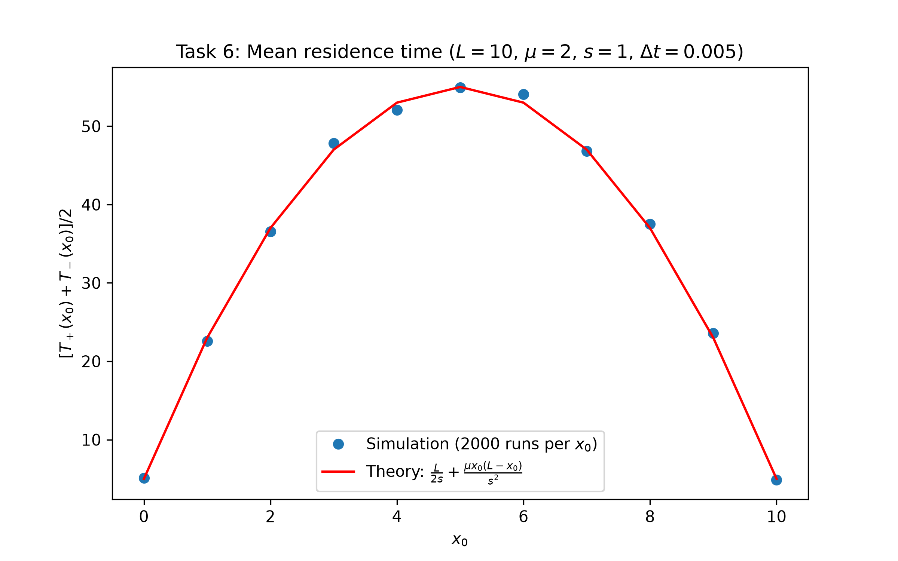
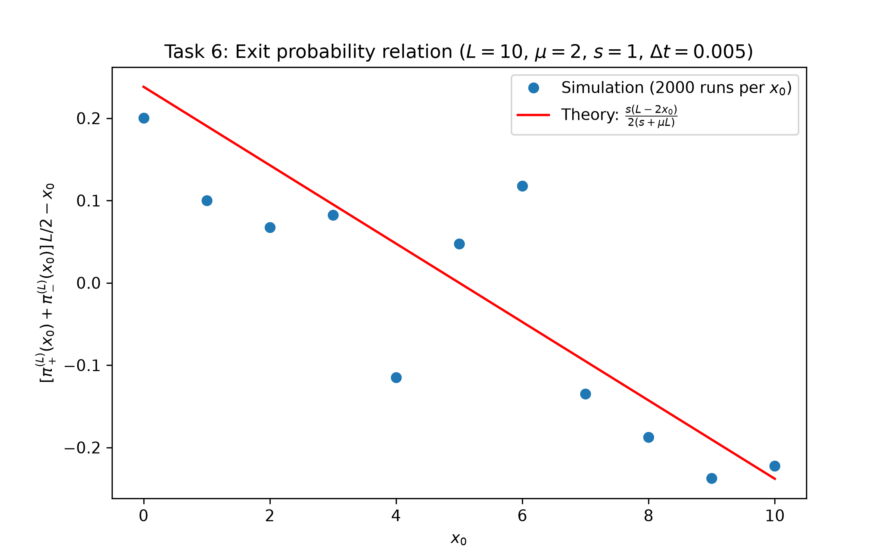
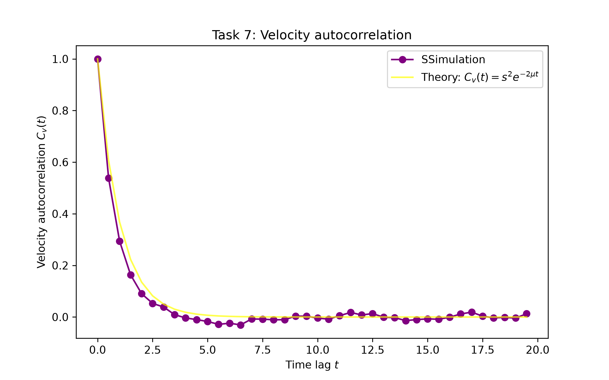
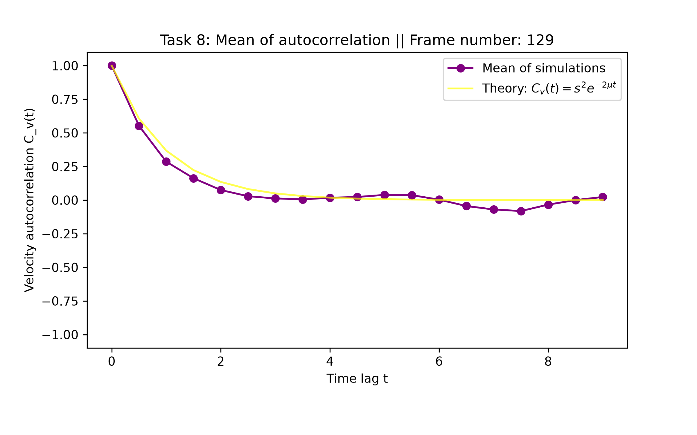
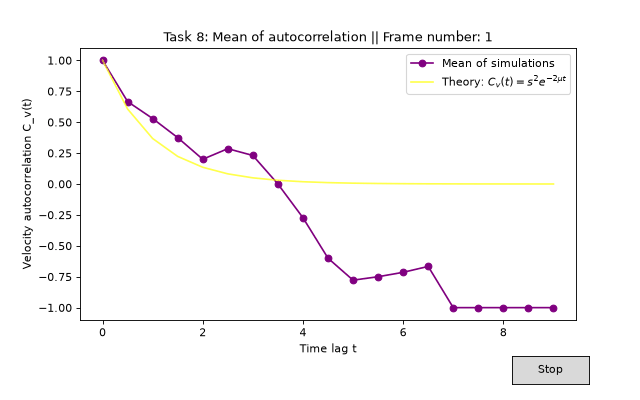

Group report 

# Poisson-Kac Task 1

In this task, we simulate N random event times distributed uniformly within a time interval [0,T] to model velocity reversal events in a Poisson-Kac process. We calculate the time intvervals $\tau$ between successive reversal events and demonstrate that their probability density function p($\tau$) follows an exponential distribution given by $p(\tau) = \mu e^{-\mu\tau}$. Here the rate parameter is defined as  $\mu = N/T$.

## Layout of the algorithm, functions to be created

The code for this task relies on numpy to generate random numbers and to make array operations. It also uses matplotlib.pyplot to visualise. The two main functions of this task are:

      def generate_poisson_intervals(N,T):
            # It generates N random event times in the interval [0,T]
            # and sorts them. The function also calculates the time
            # differences tau between consecutive events.
            return tau

      def main_function():
            # This function ist used to coordinate the simulation, to
            # calculate mu, plot the histogram against the
            # theoretical distribution and to save the resulting
            # figure.

## How to run the code

To run the code, you need to install numpy and matplotlib in your active Python environment and execute:

      python3 task1.py

N and T are predefined. So you don't need to define them.

## Resulting files

task1_distribution.png: This is a generated figure which shows the comparison between the histogram of simulated time intervals $\tau$ and the theoretical exponantial distribution curve.

## Successful tests

It has been verified that all generated event times are within the interval between 0 and 1.
We can confirm that all calculated time intervals $\tau$ are positive numbers.
The area under the probability density histogram normalizes to 1 and aligns with the theoretical rate $\mu = N/T$. This was checked numerically and visually.

## Problems

Initial environment path conflicts, package resolution issues (numpy/matplotlib) within VS Code, and minor import errors (matplotlib vs matplotlib.pyplot). All issues were successfully resolved.

## Results (speed tests etc.)

The resulting plot clearly shows that the theoretical exponantial decay curve is closely followed by the simulated data points, validation the relation $\mu = N/T$.

# Poisson-Kac Task 2

Develop an algorithm which uses the inverse transform sampling method to generate random time intervals $\tau$ for a given rate $\mu$. The density of those time intervals corresponds to the exponential distribution $p(\tau) = \mu e^{-\mu\tau}$. Starting from the analytically calculated cumulative distribution function $P(\tau) = 1 - e^{-\mu\tau}$ and uniformly distributed random numbers $P \in [0,1]$, $N$ values are generated using the formula $\tau = -\ln(1-P)/\mu$ and visually verified.

## Layout of the algorithm, functions to be created

The code for this task relies on numpy to generate random numbers and to make array operations. It also uses matplotlib.pyplot to visualise. The two main functions of this task are:

      def generate_inverse_exponential(N,mu):
            # It generates N uniformly distributed random numbers
            # in the interval [0,1] and applies the inverse transform 
            # formula tau = -ln(1 - P) / mu.
            return tau

      def main_function():
            # This function ist used to coordinate the simulation, to
            # calculate mu, plot the histogram against the theoretical
            # distribution and to save the resulting figure.

## How to run the code

To run the code, you need to install numpy and matplotlib in your active Python environment and execute:

      python3 task2.py

N and T are predefined. So you don't need to define them.

## Resulting files

task2_distribution.png: This is a generated figure which shows the comparison between the histogram of inversely sampled $\tau$ values and the theoretical exponantial probability density curve.

## Successful tests

Verified that all generated random probabilities P lie within the interval between 0 and T.
Confirmed that all calculated $\tau$ values match the expected theoretical decay rate $\mu$.
Checked visually that the histogram matches the analytical curve $p(\tau) = \mu e^{-\mu\tau}$.

## Problems

No problems encountered; the inverse transform sampling method directly produced accurate distributions that match Task 1.

## Results (speed tests etc.)

The resulting plot clearly confirms that generating time intervals via the inverse cumulative distribution function can reproduce Poisson-Kac interval statistics successfully.

# Poisson-Kac Task 3

In this task, we simulate a 1D Poisson-Kac process trajectory $x(t)$ of an atom starting at $t=0$ at position $x(0)=0$ with initial velocity $v=s$. Velocity reversal events occur at random time intervals $\tau_i = -\ln(1-P)/\mu$, where $P \sim \text{Uniform}(0, 1)$ and $\mu$ is the event rate. Between reversal events, the atom moves at constant speed $s$ with alternating directions ($v \to -v$). We compare the event-driven discrete trajectory at times $t = 0, \tau_1, \tau_1+\tau_2, \dots$ with an equidistantly sampled trajectory evaluated at fixed time steps $t_j = j \Delta t$ (with $\Delta t \ll \mu^{-1}$) to validate the algorithm.

## Layout of the algorithm, functions to be created

The code relies on numpy for random number generation and array manipulation, and matplotlib.pyplot for visual validation. The two main functions of this task are:

      def generate_event_trajectory(N, rate_mu, speed_s):
            # Generates N random time intervals tau using inverse transform sampling,
            # tracks velocity direction reversals (v -> -v), and calculates the 
            # exact particle position x(t) at each event time.
            return t_events, x_events

      def interpolate_equidistant_trajectory(t_events, x_events, speed_s, dt):
            # Constructs the continuous trajectory x(t) at fixed, regular time
            # intervals t_j = j * dt by performing piece-wise linear interpolation
            # between reversal events.
            return t_grid, x_grid

      def main_function():
            # Sets parameters (N=40, mu=10, s=1, dt=0.25/mu), coordinates the
            # trajectory generation, overlays both representations on a single plot,
            # and saves the resulting figure.

## How to run the code

To run the code, you need to install numpy and matplotlib in your active Python environment and execute:

      python3 task3.py

Parameters ($N = 40$, $\mu = 10$, $s = 1$, and $\Delta t = 0.25/\mu$) are predefined inside the code.

## Resulting files

task3_trajectory.png: This is a generated figure which shows the visual overlay of the discrete reversal events (open circles) and the equidistantly sampled trajectory (dotted line with points).

## Successful tests

It has been verified that all calculated intervals $\tau_i$ strictly follow the prescribed distribution $\tau = -\ln(1-P)/\mu$ and remain positive.
We can confirm that velocity alternates correctly ($+s, -s, +s, \dots$) after every event.
The continuous piecewise linear trajectory constructed at regular intervals $t_j = j \Delta t$ passes directly through all event positions $(t_{\text{event}}, x_{\text{event}})$, confirming the validity of the interpolation algorithm both numerically and visually.

## Problems

Handling boundary conditions between discrete event steps during continuous time interpolation required precise interval lookup logic (np.searchsorted). Potential floating-point inaccuracies when matching fixed grid times $t_j$ with event times were successfully resolved.

## Results (speed tests etc.)

The generated plot demonstrates exact agreement between the continuous piecewise linear path evaluated at regular time steps $\Delta t$ and the discrete reversal event locations, verifying the correctness of the spatial velocity-reversal algorithm.

## Task 4
In this task, we simulated the Poisson-Kac trajectory $x(t)$ directly at fixed time steps $t = 0, \Delta t, 2\Delta t, \dots$. Unlike Task 3, we did not generate the time intervals $\tau$ first. Instead, the velocity flips after each step with a fixed probability

$$f = 1 - e^{-\mu\Delta t}.$$

To test the algorithm, we saved the times when the velocity flips and compared the time between flips with $p(\tau) = \mu e^{-\mu\tau}$.

## Layout of the algorithm and functions
The code uses numpy for the random numbers and matplotlib.pyplot for the plots. The parameters are $\mu = 10$, $s = 1$, $\Delta t = 0.01/\mu = 0.001$ and $100\,000$ steps.

The particle starts at $x(0) = 0$ with velocity $v = s$. In each step:

1. The new position is calculated:
$$x(j\Delta t) = x((j-1)\Delta t) + v\,\Delta t$$
2. A random number $r$ between 0 and 1 is drawn.
3. If $r < f$, the velocity flips ($v \to -v$) and the step number is saved.

The time between two flips is the difference of the saved step numbers times $\Delta t$. These times were plotted as a histogram together with the theoretical curve $p(\tau) = \mu e^{-\mu\tau}$.

## How to run the code
Install numpy and matplotlib and run:

    Poisson-Kac_VibeCoders_Notebook.ipynb #Task 4

## Resulting files
- images/task4_poisson-kac-trajectory_Nicola.png: the trajectory $x(t)$ for the first 4000 steps.
- images/task4_waiting_times_Nicola.png: histogram of the times between flips compared with $p(\tau)$.

## Successful tests
The trajectory has straight lines going up and down with slope $\pm s$, like in Task 3.
The histogram follows the theoretical curve.
The mean time between flips is close to $1/\mu = 0.1$.

## Results and limitations
The algorithm works: the trajectory looks like Task 3 and the times between flips follow the exponential curve.
The simulated times can only be multiples of $\Delta t$, so the result is not exactly exponential. With about 1000 flips, the histogram is still a bit noisy for large $\tau$, because only a few flips fall into the bins.

## Task 5
In this task, we used the step algorithm from Task 4 inside a fixed interval $[0, L]$. The particle starts at $x(0) = x_0$ with velocity $v = s$ and moves until it reaches $x \leq 0$ or $x \geq L$. We calculated the probability $\pi_+^{(L)}(x_0)$ that the particle leaves the interval at $x = L$ and compared it with the theoretical prediction

$$\pi_+^{(L)}(x_0) = \frac{s + \mu x_0}{s + \mu L}.$$

## Layout of the algorithm and functions
The code uses numpy for the random numbers and matplotlib.pyplot for the plots. The parameters are $L = 10$, $\mu = 2$, $s = 1$ and $\Delta t = 0.01/\mu = 0.005$.

The function probability_exit(x0) runs 2000 simulations for one starting position $x_0$. In each simulation:

1. The particle starts at $x = x_0$ with velocity $v = s$.
2. It moves with the algorithm from Task 4: $x \to x + v\,\Delta t$, then the velocity flips with probability $f = 1 - e^{-\mu\Delta t}$.
3. If $x \leq 0$, the particle left at 0. If $x \geq L$, it left at $L$. In both cases the simulation stops.

The function returns the number of simulations that ended at $L$ divided by 2000. This was done for 11 starting positions $x_0 = 0, 1, \dots, 10$.

## How to run the code
Install numpy and matplotlib and run:

    Poisson-Kac_VibeCoders_Notebook.ipynb #Task 5

## Resulting files
- images/task5_exit_probability_Nicola.png: simulated $\pi_+^{(L)}(x_0)$ compared with the theory.

## Successful tests
The simulated points lie close to the theoretical straight line.
At $x_0 = L$, the particle leaves at $L$ in the first step, so $\pi_+^{(L)}(L) = 1$, as the theory predicts.
At $x_0 = 0$, the particle does not leave right away, because it starts moving to the right. The probability is small but not zero.

## Results and limitations
The simulation agrees with the theory: the probability of leaving at $L$ grows linearly with $x_0$.

## Task 6
In this task, we used the same algorithm as in Task 5 to calculate the mean time $T_\pm(x_0)$ that the particle stays inside the interval $[0, L]$ when it starts at $x_0$ with velocity $\pm s$. We compared the average of both with the theoretical prediction

$$\frac{T_+(x_0) + T_-(x_0)}{2} = \frac{L}{2s} + \frac{\mu x_0 (L - x_0)}{s^2}.$$

In the same simulations, we also checked the relation

$$\frac{\pi_+^{(L)}(x_0) + \pi_-^{(L)}(x_0)}{2}\,L - x_0 = \frac{s(L - 2x_0)}{2(s + \mu L)}.$$

## Layout of the algorithm and functions
The code uses numpy for the random numbers and matplotlib.pyplot for the plots. The parameters are $L = 10$, $\mu = 2$, $s = 1$ and $\Delta t = 0.01/\mu = 0.005$.

The function exit_statistics(x0, v0) runs 100 simulations for one starting position $x_0$ and starting velocity $v_0 = \pm s$. In each simulation:

1. The particle starts at $x = x_0$ with velocity $v_0$.
2. It moves with the algorithm from Task 4, and the number of steps is counted.
3. When the particle reaches $x \leq 0$ or $x \geq L$, the simulation stops. The time in the interval is the number of steps times $\Delta t$, and we save whether it left at $L$ (1) or at 0 (0).

The function returns the mean time and the fraction of runs that left at $L$. It was called for 11 starting positions $x_0 = 0, 1, \dots, 10$, once with $v_0 = +s$ and once with $v_0 = -s$. This gives $T_+$, $T_-$, $\pi_+^{(L)}$ and $\pi_-^{(L)}$ for each $x_0$.

## How to run the code
Install numpy and matplotlib and run:

    Poisson-Kac_VibeCoders_Notebook.ipynb #Task 6

## Resulting files
- images/task6_residence_time_Nicola.png: mean time in the interval compared with the theory.
- images/task6_exit_probability_relation_Nicola.png: exit probability relation compared with the theory.

## Successful tests
The simulated mean time follows the theoretical curve: about 5 at the edges and about 55 in the middle.
For the second relation, the simulated points scatter around the theoretical line, but they roughly follow its trend. With more simulations, the results would likely get closer to the theory.

## Results and limitations
The simulation agrees with the theory for the mean time. The run time grows linearly with the number of simulations. On top of that, the particle stays much longer in the interval than in Task 5. Even with 2000 runs, the second plot is very noisy. To see the relation clearly, several thousand runs per point would be needed, whcih would take a long time for this algorithm.

## Task 7
In this task, it is asked to calculate the velocity autocorrelation of a Poisson-Kac particle. This quantity is a description of how the velocity loses memory of its initial direction as the time goes on. The simulation created was compared with the theoretical prediction $$C_v(t)=s^2e^{-2\mu t}.$$

## Layout of the algorithm and functions

The step at fixed time movement and velocity reversal algorithms from Task 4 were reused, together with the boundary termination condition from Task 5. The parameters are $x_0=50$, $\mu=0.5$, $s=1$, $L=3000$, and $\Delta t=0.5$. The initial velocity at the start of simulation is positive. 
The function "generate_trajectory(x0,mu,s,dt,L)" generates one single trajectory until the particle reaches one of the boundaries. It stores the position and velocity used for every movement step. The velocity is recorded before the movement and the possible reversal of it.
The function "calculate_autocorrelation(v_values,dt)" is used to compare velocity values separated by $j$ time steps and calculating $$C_v(j\Delta t)=\frac{1}{N-j}\sum_{k=1}^{N-j}v_kv_{k+j}.$$ Here $N$ is the number of movement steps. Each sum is then divided by the number of available pairs, which is $N-j$.
40 time lags are evaluated, from $0$ to $19.5$, satisfying the requirement of the task of $t<20$.

## Resulting file from the code
THe figure of the resulting graph is saved as images/task7_autocorrelation.png.

The Figure 7 is the velocity autocorrelation estimated from one simulated trajectory, shown by the purple markers and line, and put in comparison with the continuous theoretical prediction, shown in yellow. Parameters: $x_0=50$, $\mu=0.5$, $s=1$, $L=3000$, and $\Delta t=0.5$. The displayed realization contains 4496 steps and has a total duration of 2248.0.

## Successful tests
For the realization, the program terminal returned  $C_v(0)=1$, and this is expected from $C_v(0)=s^2$. At zero time lag, each velocity is multiplied by itself. The reported duration is consistent with the number of steps: $$T=N\Delta t=4496\times0.5=2248.$$

## Results and limitations
The simulated correlation is shown to decrease rapidly from its initial value of 1. At larger time lags, it can sometimes fluctuate above and below zero, so including negative values estimated. These fluctuation exists because of the finite length of the simulated trajectory.
The comparison also depends on the finite time step. The decided reversal probability $f=1-e^{-\mu\Delta t}$ is retained. For this discrete algorithm, the corresponding theoretical correlation is $s^2(1-2f)^j$ at lag $j\Delta t$, which as the time step decreases slowly approaches the continous expression. Therefore, some systematic difference from the continuous reference of the theory is expected with $\Delta t=0.5$.
The diffusion coefficient associated with the continuous theoretical prediction is $$D=\int_0^\infty C_v(t)\,dt=\frac{s^2}{2\mu}=1.$$
This values is calculated from the formula given in the task.

## Task 8
In this task, it was asked to extend the previous task 7 by averaging the velocity autocorrelation over many independent short trajectories. The aim was to observe how the estimate changes when more and more realizations are added with time, while allowing the simulation to be stopped with a click on a dedicated button located in the same graph window of the program.

## Layout of the algorithm and functions
The functions generate_trajectory and calculate_autocorrelation from task 7 were reused. The parameters remained the same: $x_0=50$, $\mu=0.5$, $s=1$, $L=3000$, and $\Delta t=0.5$, with positive initial velocity.
The additional argument max_steps limits each trajectory to maximum 19 movement steps. Its duration is therefore  $19\times0.5=9.5$, which makes the requirement of the task $T<5/\mu=10$ satisfied.
For each new trajectory generated, its autocorrelation is calculated and added to a running sum. After $M$ realizations, the average is $$\overline{C_v}(t)=\frac{1}{M}\sum_{r=1}^{M}C_{v,r}(t).$$
19 time lags are evaluated, from $0$ to $9.0$. After the end of every realization, the existing curve stored is updated using line.set_ydata, the frame number is displayed and counts these updates near the title, and finally with the help of PillowWriter a new animation frame is recorded.
The function stop(event) changes the variable running to False when the button Stop is clicked. The loop then ends, the final data and figure are saved completing the GIF.

## Resulting files
The program produces as output: 
- data/Cv.csv: time lags and the final average values of autocorrelation.
- images/task8_autocorrelation.png: final comparison with the continuous prediction of theory.
- images/task8_autocorrelation.gif: evolution of the averaged curve, with one frame per realization.

Figure 8: Velocity autocorrelation averaged over 129 independent short trajectories. Purple markers and line represent the simulation, while the yellow line represents the continuous prediction of theory. Each trajectory should contain 19 movement steps and lasts 9.5 time units.

Animation 8: Evolution of the averaged autocorrelation as new realization are added updating the GIF. The animation contains 129 frames and the number of frames that keeps going up indicates how many realizations contribute to each average being displayed at every current moment.

## SUccessful tests
The final averaged autocorrelation satisfies the request of $\overline{C_v}(0)=1=s^2$, as expected.
The Stop button was tested with success, since when clicked the simulation stops, the output files save and the plot window is closed and afterwards the saves file shows the correct frames at which the button was clicked.

## Difficulties and solutions
This task was more difficult than the previous ones because it combined the simulation with an interactive graph and needed a saving method for every frame of the animation.
Working with fig, ax and ax.plot was at first confusing. It was neede to understang how to create a curve once and update its values, instead of producing a new graph every iteration of the program.
PillowWriter was also a new tool and a button inside a plot window was a new challenge as well. Placing the Stop button, connecting it to a function, and checking that a click actually stopped the loop at the right frame required more work and study than initially expected.
It was noted that an error in the code of the process of saving the GIF could also be a consequence of an earlier problem that prevented any frames from being correctly recorded.
The most confusing issue was the plotting mode. The figure initially appeared as a static image inside the notebook used, and the animation could not run correctly. 

## Results and limitations
Averaging more realization reduces random fluctuation and makes the estimated autocorrelation more stable overall.
The final curve shows a rapid decay from 1 and smaller fluctuation around zero at larger time lags, similar to task 7. The animation demonstrates the evolution of the estimate.
As in Task 7, an effect of the time being finite remains. The prescribed reversal probability is $f=1-e^{-\mu\Delta t}$, and the corresponding discrete correlation is $s^2(1-2f)^j$ at lag $j\Delta t$. It was noticed that increasing the number of realizations slowly reduces the sampling noise but does not remove this difference from the theory values.