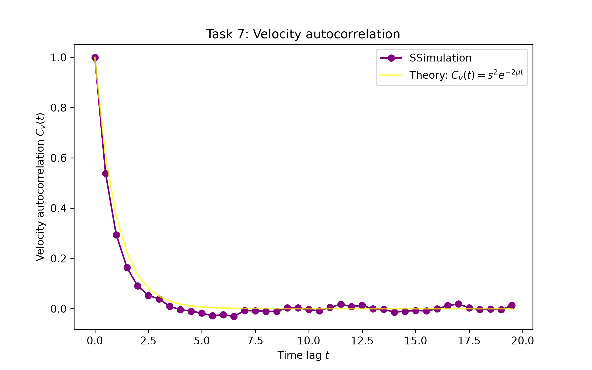

Group report 

# Poisson-Kac Task 1

In this task, we simulate N random event times distributed uniformly within a time interval [0,T] to model velocity reversal events in a Poisson-Kac process. We calculate the time intvervals $\tau$ between successive reversal events and demonstrate that their probability density function p($\tau$) follows an exponential distribution given by $p(\tau) = \mu e^{-\mu\tau}$. Here the rate parameter is defined as  $\mu = N/T$.

## Layout of the algorithm, functions to be created

The code for this task relies on numpy to generate random numbers and to make array operations. It also uses matplotlib.pyplot to visualise. The two main functions of this task are:

      def generate_poisson_intervals(N,T):
            # It generates N random event times in the interval [0,T]
            # and sorts them. The function also calculates the time
            # differences tau between consecutive events.
            return tau

      def main_function():
            # This function ist used to coordinate the simulation, to
            # calculate mu, plot the histogram against the
            # theoretical distribution and to save the resulting
            # figure.

## How to run the code

To run the code, you need to install numpy and matplotlib in your active Python environment and execute:

      python3 task1.py

N and T are predefined. So you don't need to define them.

## Resulting files

task1_distribution.png: This is a generated figure which shows the comparison between the histogram of simulated time intervals $\tau$ and the theoretical exponantial distribution curve.

## Successful tests

It has been verified that all generated event times are within the interval between 0 and 1.
We can confirm that all calculated time intervals $\tau$ are positive numbers.
The area under the probability density histogram normalizes to 1 and aligns with the theoretical rate $\mu = N/T$. This was checked numerically and visually.

## Problems

Initial environment path conflicts, package resolution issues (numpy/matplotlib) within VS Code, and minor import errors (matplotlib vs matplotlib.pyplot). All issues were successfully resolved.

## Results (speed tests etc.)

The resulting plot clearly shows that the theoretical exponantial decay curve is closely followed by the simulated data points, validation the relation $\mu = N/T$.

# Poisson-Kac Task 2

Develop an algorithm which uses the inverse transform sampling method to generate random time intervals $\tau$ for a given rate $\mu$. The density of those time intervals corresponds to the exponential distribution $p(\tau) = \mu e^{-\mu\tau}$. Starting from the analytically calculated cumulative distribution function $P(\tau) = 1 - e^{-\mu\tau}$ and uniformly distributed random numbers $P \in [0,1]$, $N$ values are generated using the formula $\tau = -\ln(1-P)/\mu$ and visually verified.

## Layout of the algorithm, functions to be created

The code for this task relies on numpy to generate random numbers and to make array operations. It also uses matplotlib.pyplot to visualise. The two main functions of this task are:

      def generate_inverse_exponential(N,mu):
            # It generates N uniformly distributed random numbers
            # in the interval [0,1] and applies the inverse transform 
            # formula tau = -ln(1 - P) / mu.
            return tau

      def main_function():
            # This function ist used to coordinate the simulation, to
            # calculate mu, plot the histogram against the theoretical
            # distribution and to save the resulting figure.

## How to run the code

To run the code, you need to install numpy and matplotlib in your active Python environment and execute:

      python3 task2.py

N and T are predefined. So you don't need to define them.

## Resulting files

task2_distribution.png: This is a generated figure which shows the comparison between the histogram of inversely sampled $\tau$ values and the theoretical exponantial probability density curve.

## Successful tests

Verified that all generated random probabilities P lie within the interval between 0 and T.
Confirmed that all calculated $\tau$ values match the expected theoretical decay rate $\mu$.
Checked visually that the histogram matches the analytical curve $p(\tau) = \mu e^{-\mu\tau}$.

## Problems

No problems encountered; the inverse transform sampling method directly produced accurate distributions that match Task 1.

## Results (speed tests etc.)

The resulting plot clearly confirms that generating time intervals via the inverse cumulative distribution function can reproduce Poisson-Kac interval statistics successfully.

# Poisson-Kac Task 3

In this task, we simulate a 1D Poisson-Kac process trajectory $x(t)$ of an atom starting at $t=0$ at position $x(0)=0$ with initial velocity $v=s$. Velocity reversal events occur at random time intervals $\tau_i = -\ln(1-P)/\mu$, where $P \sim \text{Uniform}(0, 1)$ and $\mu$ is the event rate. Between reversal events, the atom moves at constant speed $s$ with alternating directions ($v \to -v$). We compare the event-driven discrete trajectory at times $t = 0, \tau_1, \tau_1+\tau_2, \dots$ with an equidistantly sampled trajectory evaluated at fixed time steps $t_j = j \Delta t$ (with $\Delta t \ll \mu^{-1}$) to validate the algorithm.

## Layout of the algorithm, functions to be created

The code relies on numpy for random number generation and array manipulation, and matplotlib.pyplot for visual validation. The two main functions of this task are:

      def generate_event_trajectory(N, rate_mu, speed_s):
            # Generates N random time intervals tau using inverse transform sampling,
            # tracks velocity direction reversals (v -> -v), and calculates the 
            # exact particle position x(t) at each event time.
            return t_events, x_events

      def interpolate_equidistant_trajectory(t_events, x_events, speed_s, dt):
            # Constructs the continuous trajectory x(t) at fixed, regular time
            # intervals t_j = j * dt by performing piece-wise linear interpolation
            # between reversal events.
            return t_grid, x_grid

      def main_function():
            # Sets parameters (N=40, mu=10, s=1, dt=0.25/mu), coordinates the
            # trajectory generation, overlays both representations on a single plot,
            # and saves the resulting figure.

## How to run the code

To run the code, you need to install numpy and matplotlib in your active Python environment and execute:

      python3 task3.py

Parameters ($N = 40$, $\mu = 10$, $s = 1$, and $\Delta t = 0.25/\mu$) are predefined inside the code.

## Resulting files

task3_trajectory.png: This is a generated figure which shows the visual overlay of the discrete reversal events (open circles) and the equidistantly sampled trajectory (dotted line with points).

## Successful tests

It has been verified that all calculated intervals $\tau_i$ strictly follow the prescribed distribution $\tau = -\ln(1-P)/\mu$ and remain positive.
We can confirm that velocity alternates correctly ($+s, -s, +s, \dots$) after every event.
The continuous piecewise linear trajectory constructed at regular intervals $t_j = j \Delta t$ passes directly through all event positions $(t_{\text{event}}, x_{\text{event}})$, confirming the validity of the interpolation algorithm both numerically and visually.

## Problems

Handling boundary conditions between discrete event steps during continuous time interpolation required precise interval lookup logic (np.searchsorted). Potential floating-point inaccuracies when matching fixed grid times $t_j$ with event times were successfully resolved.

## Results (speed tests etc.)

The generated plot demonstrates exact agreement between the continuous piecewise linear path evaluated at regular time steps $\Delta t$ and the discrete reversal event locations, verifying the correctness of the spatial velocity-reversal algorithm.

## Task 7
In this task, it is asked to calculate the velocity autocorrelation of a Poisson-Kac particle. This quantity is a description of how the velocity loses memory of its initial direction as the time goes on. The simulation created was compared with the theoretical prediction $$C_v(t)=s^2e^{-2\mu t}.$$

## Layout of the algorithm and functions

The step at fixed time movement and velocity reversal algorithms from Task 4 were reused, together with the boundary termination condition from Task 5. The parameters are $x_0=50$, $\mu=0.5$, $s=1$, $L=3000$, and $\Delta t=0.5$. The initial velocity at the start of simulation is positive. 
The function "generate_trajectory(x0,mu,s,dt,L)" generates one single trajectory until the particle reaches one of the boundaries. It stores the position and velocity used for every movement step. The velocity is recorded before the movement and the possible reversal of it.
The function "calculate_autocorrelation(v_values,dt)" is used to compare velocity values separated by $j$ time steps and calculating $$C_v(j\Delta t)=\frac{1}{N-j}\sum_{k=1}^{N-j}v_kv_{k+j}.$$ Here $N$ is the number of movement steps. Each sum is then divided by the number of available pairs, which is $N-j$.
40 time lags are evaluated, from $0$ to $19.5$, satisfying the requirement of the task of $t<20$.

## Resulting file from the code
THe figure of the resulting graph is saved as images/task7_autocorrelation.png.

The Figure 7 is the velocity autocorrelation estimated from one simulated trajectory, shown by the purple markers and line, and put in comparison with the continuous theoretical prediction, shown in yellow. Parameters: $x_0=50$, $\mu=0.5$, $s=1$, $L=3000$, and $\Delta t=0.5$. The displayed realization contains 4496 steps and has a total duration of 2248.0.

## Successful tests
For the realization, the program terminal returned  $C_v(0)=1$, and this is expected from $C_v(0)=s^2$. At zero time lag, each velocity is multiplied by itself. The reported duration is consistent with the number of steps: $$T=N\Delta t=3420\times0.5=1710.$$

## Results and limitations
The simulated correlation is shown to decrease rapidly from its initial value of 1. At larger time lags, it can sometimes fluctuate above and below zero, so including negative values estimated. These fluctuation exists because of the finite length of the simulated trajectory.
The comparison also depends on the finite time step. The decided reversal probability $f=1-e^{-\mu\Delta t}$ is retained. For this discrete algorithm, the corresponding theoretical correlation is $s^2(1-2f)^j$ at lag $j\Delta t$, which as the time step decreases slowly approaches the continous expression. Therefore, some systematic difference from the continuous reference of the theory is expected with $\Delta t=0.5$.
The diffusion coefficient associated with the continuous theoretical prediction is $$D=\int_0^\infty C_v(t),dt=\frac{s^2}{2\mu}=1.$$
This values is calculated from the formula given in the task.